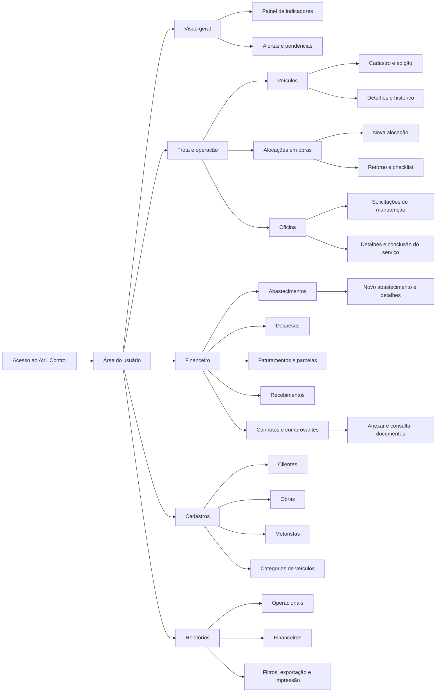
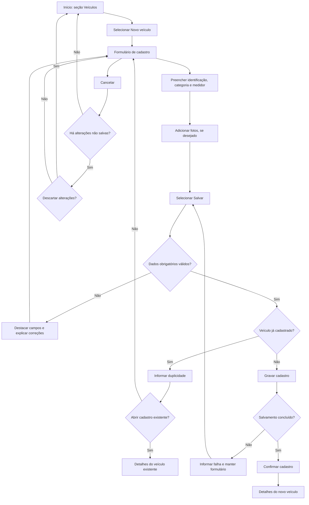
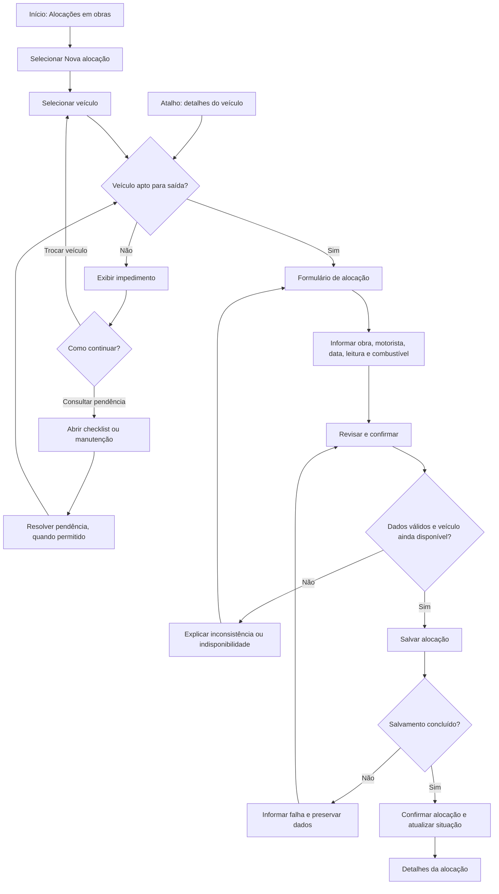
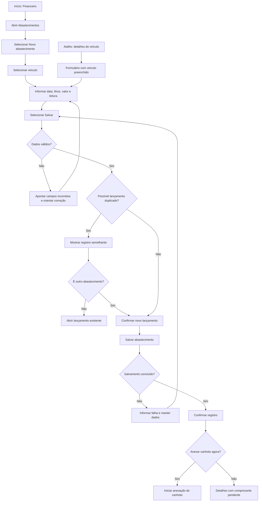
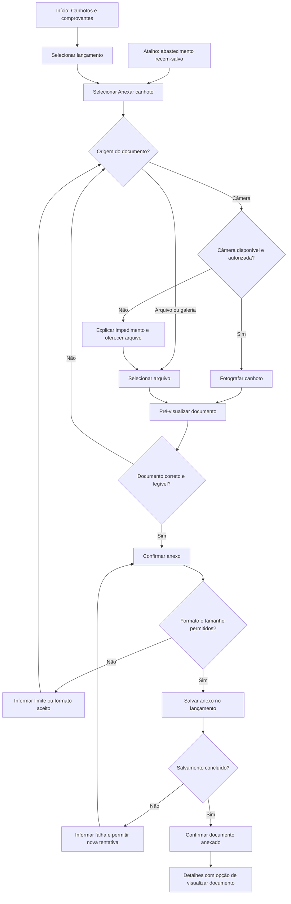

# Arquitetura de Informação e Fluxo do Usuário

**1. Arquitetura de Informação — Sitemap**

O conteúdo está organizado em cinco áreas principais: **Visão geral, Frota e operação, Financeiro, Cadastros e Relatórios**. A identificação do perfil determina quais informações e ações serão apresentadas ao usuário.

Os formulários e detalhes são telas internas de cada seção. **Obras e Motoristas são propostos como cadastros reutilizáveis**, evitando digitar as mesmas informações em cada alocação.

| Área | Conteúdo e finalidade |
| :---- | :---- |
| **Acesso** | Identificação do usuário e apresentação das funcionalidades compatíveis com seu perfil. Na demonstração, a seleção de perfil pode simular essa entrada. |
| **Visão geral** | Resumo da operação, indicadores e pendências, com atalhos para os registros que exigem atenção. |
| **Frota e operação** | Cadastro e acompanhamento de veículos, alocações, retornos, checklists e manutenções. |
| **Financeiro** | Abastecimentos, despesas, faturamentos, parcelas, recebimentos e documentos comprobatórios. |
| **Cadastros** | Informações utilizadas em diferentes tarefas: clientes, obras, motoristas e categorias. |
| **Relatórios** | Consulta consolidada das informações operacionais e financeiras, com filtros e opções de exportação. |

**Justificativa da organização**

Como as personas não foram formalizadas nesta etapa, a organização considera os seguintes perfis de uso derivados dos cenários do sistema:

| Perfil de referência | Necessidade e cenário | Decisão de arquitetura |
| :---- | :---- | :---- |
| **Locador ou gestor de frota** | Consultar disponibilidade, situação dos veículos, manutenção e resultados das locações. | Concentrar veículos e manutenção em “Frota e operação”, com acesso ao histórico de cada veículo. |
| **Locatário ou responsável pela obra** | Identificar veículos disponíveis, alocar recursos e registrar o retorno. | Agrupar alocação, retorno e checklist na mesma área, acompanhando a sequência da operação. |
| **Responsável por registros em campo** | Registrar abastecimentos e fotografar comprovantes com pouco tempo disponível. | Oferecer acesso direto ao abastecimento e ao envio do canhoto, inclusive a partir dos detalhes do veículo. |
| **Equipe administrativa e financeira** | Conferir despesas, documentos, parcelas e recebimentos. | Reunir lançamentos e comprovantes em “Financeiro”, com relatórios próprios para análise. |

A separação entre **Cadastros** e **Operação** permite reutilizar informações sem confundir a manutenção dos dados com as tarefas diárias. Já os detalhes do veículo funcionam como um ponto de conexão: dali, o usuário pode consultar histórico, iniciar uma alocação ou registrar um abastecimento.

**2. Fluxo do Usuário — User Flow**

Nos diagramas, os losangos representam decisões. Os caminhos de correção retornam ao formulário preservando os dados já preenchidos. Os atalhos indicam entradas alternativas para a mesma funcionalidade.

**2.1. Cadastrar veículo**

**Funcionalidade:** registrar a identificação e as características de um veículo.

**Objetivo do usuário:** disponibilizar um cadastro confiável para consultas, alocações e lançamentos posteriores.

**Atalho e caminhos alternativos:** ao identificar uma duplicidade, o usuário pode abrir o cadastro existente. Após salvar, pode iniciar uma alocação diretamente pelos detalhes do veículo, quando essa ação estiver disponível para seu perfil.

**2.2. Alocar veículo em obra**

**Funcionalidade:** vincular um veículo a uma obra e registrar motorista, data, leitura e combustível de saída.

**Objetivo do usuário:** registrar a utilização do veículo e identificar onde ele está e quem é responsável por sua operação.

**Atalho e caminhos alternativos:** ao entrar pelos detalhes do veículo, a seleção já vem preenchida. Se houver manutenção impeditiva ou checklist pendente, o usuário pode consultar a pendência ou escolher outro veículo. O impedimento deve ser explicado antes do preenchimento completo.

**2.3. Registrar abastecimento**

**Funcionalidade:** registrar o abastecimento de um veículo com data, quantidade de combustível, valor e leitura do medidor.

**Objetivo do usuário:** manter o histórico de consumo e despesas associado ao veículo correto.

**Atalho e caminhos alternativos:** o acesso pelo veículo reduz o preenchimento e o risco de associação incorreta. Propõe-se permitir o envio posterior do canhoto, mantendo uma pendência visível. Essa regra deverá ser confirmada conforme a necessidade de conferência financeira.

**2.4. Anexar canhoto ou comprovante**

**Funcionalidade:** associar um documento comprobatório a um lançamento existente.

**Objetivo do usuário:** comprovar a operação e permitir sua consulta e conferência posteriores.

**Atalho e caminhos alternativos:** a anexação pode começar imediatamente após o abastecimento, com o lançamento já selecionado. Se a câmera não estiver disponível ou sua permissão for negada, o usuário pode escolher um arquivo. Caso saia antes de concluir, o lançamento permanece com a indicação de comprovante pendente.

**Regras de navegação comuns aos quatro fluxos**

| Regra | Comportamento esperado |
| :---- | :---- |
| **Orientação** | Exibir título da tela, seção ativa e identificação do veículo ou lançamento em edição. |
| **Navegação por teclado** | Permitir avançar com Tab, retornar com Shift + Tab e acionar controles com as teclas apropriadas, mantendo o foco visível. |
| **Correção de erros** | Informar o problema próximo ao campo, orientar a correção e preservar os demais dados preenchidos. |
| **Retorno e cancelamento** | Oferecer saída clara e confirmar o descarte quando existirem alterações não salvas. |
| **Confirmação de sucesso** | Confirmar apenas após o salvamento e oferecer acesso ao registro resultante. |
| **Continuidade da tarefa** | Preservar o contexto nos atalhos, levando o veículo ou lançamento selecionado para a próxima tela. |
